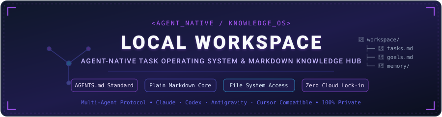
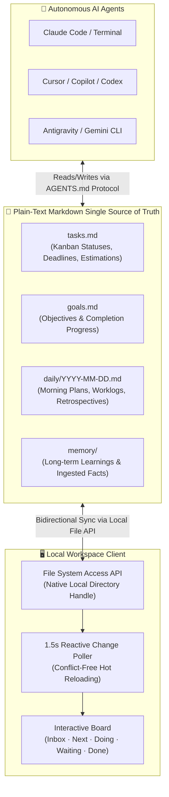

<p align="center">
  
</p>

<p align="center">
  <a href="https://github.com/Rithikasri-code/workspace"></a>
  
  
  
  
  <a href="LICENSE"></a>
</p>

---

## ⚡ Overview

**Workspace** is an agent-native personal operating system and task management architecture where **plain Markdown files** on your computer serve as the verifiable, version-controlled single source of truth.

Instead of locking task metadata, goals, and daily plans into proprietary SaaS silos, Workspace enables autonomous AI agents (**Claude Code**, **Codex**, **Antigravity**, **Cursor**) to read, organize, plan, and update your workspace through natural conversation, while a zero-dependency **live browser dashboard** provides real-time visualization via the Chromium **File System Access API**.

---

## 🏗️ Architecture & Interaction Flow



---

## 🚀 Core Architectural Capabilities

### 1. **Agent-Native Standard Protocol (`AGENTS.md`)**
The behavior, file conventions, syntax grammar, and task rollover rules are codified directly in [`AGENTS.md`](AGENTS.md) and [`.agents/skills/`](.agents/skills), adhering to the open **Agent Skills** specification. Any coding agent instantly understands how to parse and edit your workspace without custom API servers.

### 2. **File System Access API (Zero Cloud Lock-in)**
The dashboard connects directly to your local file system folder using modern browser File System Access APIs. No web servers, no databases, no cloud authentication, and no data telemetry.

### 3. **Conflict-Free Reactive Hot Reloading**
The client monitors file timestamps every 1.5 seconds. If an autonomous agent completes tasks in the background, the visual Kanban board and goal metrics update smoothly without overwriting in-flight user edits.

### 4. **Selective Memory & Ingestion Subsystem (`ingest`)**
Includes automated ingestion procedures that filter noise from communication channels (Slack, GitHub PRs, meeting notes) into clean, actionable task cards.

---

## 🔄 Daily Workflow Matrix

| Phase | What you tell your Agent | Real-time Dashboard Reflection |
| :--- | :--- | :--- |
| **Capture** | *"capture: review payment protocol PR"* | Instantly creates a card in `Inbox` |
| **Morning** | *"plan the day"* | Selects Top 3 priorities, moves to `Doing`, generates `daily/` log |
| **Execution** | *"sent PR for review, blocked on CI"* | Automatically shifts card to `Waiting` |
| **Wrap-up** | *"/capture"* | Extracts key architectural decisions into `memory/` |
| **Shutdown** | *"shut down the day"* | Marks completed items, drafts tomorrow's `Next` column |

---

## 💻 Quickstart

### Option 1: Instant Browser Access (Recommended)
Open any Chromium-based browser (Chrome, Edge, Brave, Arc) and load [`index.html`](index.html):
```bash
# Serve locally with Python:
python scripts/app.py
```
1. Click **Open Folder**.
2. Select your `workspace` repository root.
3. Grant read/write permission to begin real-time tracking.

### Option 2: Connecting Your AI Agent
* **Antigravity / Cursor / Codex:** Open the folder directly—the agent will automatically detect and parse `AGENTS.md`.
* **Claude Code:** Run the initialization helper:
  ```bash
  python scripts/setup.py
  ```

---

## 📂 Vault Structure

```
├── AGENTS.md              # Machine-readable instructions for autonomous agents
├── tasks.md               # Primary task board (Inbox, Next, Doing, Waiting, Done)
├── goals.md               # High-level strategic goals with metric tracking
├── daily/                 # Day-by-day notes and plans (YYYY-MM-DD.md)
├── memory/                # Durable knowledge base and confirmed learnings
├── projects/              # Detailed project briefs and architecture records
├── app/                   # Single-page zero-dependency dashboard
└── scripts/               # Developer automation scripts (app.py, setup.py)
```

---

## 📄 License

Distributed under the **MIT License**. See [LICENSE](LICENSE) for details.
